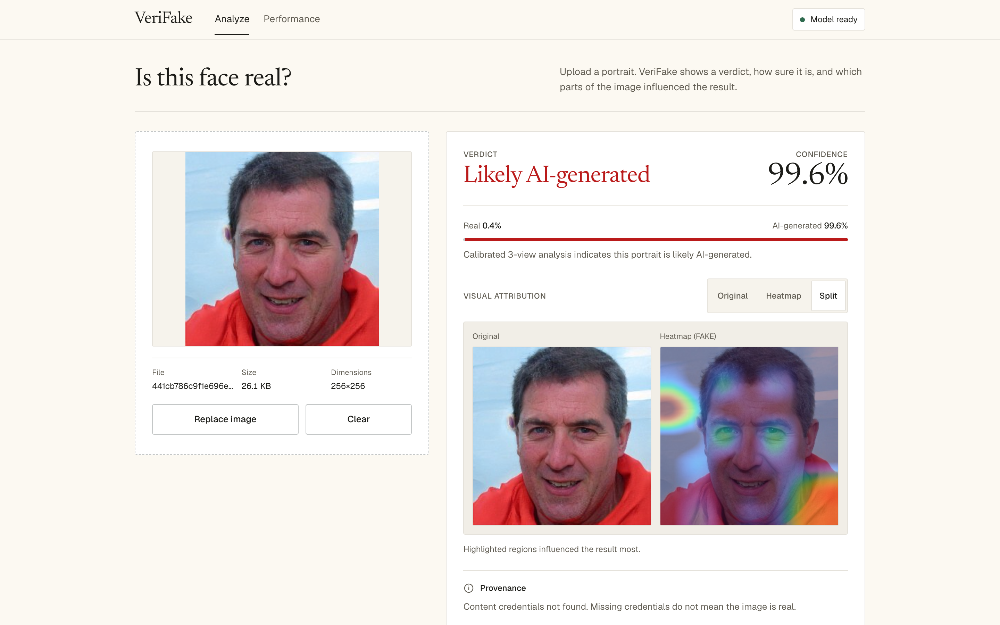
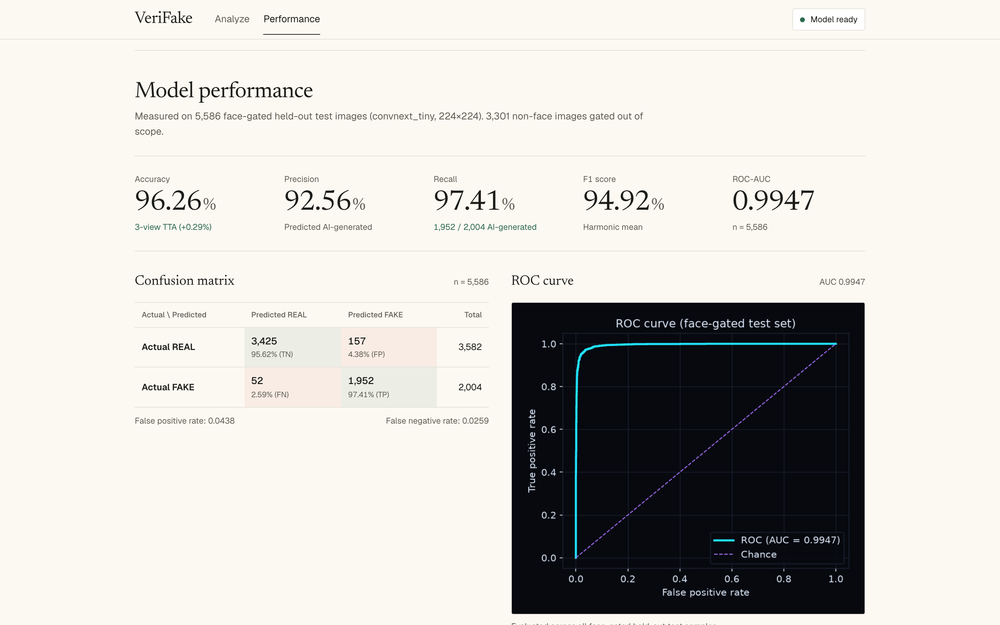

# VeriFake

VeriFake checks whether a face portrait is real or AI-generated using an ensemble of frozen CLIP ViT-L/14 features and a fine-tuned ConvNeXt-Tiny classifier trained on real photos, diffusion generators, GANs, and face-swap deepfakes.

## What it does

You upload a portrait in a browser or via `POST /predict` in JPEG, PNG, WEBP, BMP, TIFF, GIF, AVIF, or HEIC/HEIF up to 15 MB. First, a YuNet detector verifies that the image actually contains a human face so the classifier does not guess on landscapes or objects. By default (`VERIFAKE_DETECTOR=auto`), the v2 detector (`src/ensemble_inference.py`) evaluates both the face crop and full frame through a frozen CLIP ViT-L/14 MLP probe (`w = 0.65`) and a fine-tuned ConvNeXt-Tiny v2 model (`w = 0.35`), applies bounded validation calibration (`T = 1.0000`, `b = +0.8537`), and abstains to `UNCERTAIN` when views disagree, branches disagree, or confidence falls in the uncertain band (`[0.3627, 0.6310]`). Visual attribution uses Grad-CAM over ConvNeXt feature maps, while Content Credentials (C2PA / JUMBF / XMP / EXIF) are checked separately (`VERIFAKE_DETECTOR=legacy` switches back to the single-branch `models/best.pt` model). Images are processed in memory and not stored.





## Results

All metrics below are measured on the untouched 5,586-image face-gated test split (`reports/metrics.json`). That split was never used for model selection, hyperparameter tuning, or calibration.

| Metric | Value | Notes |
| --- | ---: | --- |
| Accuracy (3-view TTA) | 96.26% | Single-view crop is 95.97% |
| Precision | 92.56% | 3,425 TN, 157 FP, 52 FN, 1,952 TP |
| Recall | 97.41% | 1,952 / 2,004 AI-generated faces caught |
| F1 score | 0.9492 | Up from 0.9453 single-view |
| ROC-AUC | 0.9947 | Held-out face-gated test split |
| Test ECE | 0.0148 | Down from 0.0436 via T = 0.6095 |
| Uncertain predictions | 29 / 5,586 | 96.58% accuracy on 5,557 decisive calls |
| Unseen Midjourney | 95.50% | n = 489 faces; AUC 0.9903 vs. test real |

Per-source accuracy across the test split and held-out unseen Midjourney set:

| Source | Class | Faces | Accuracy | Uncertain |
| --- | --- | ---: | ---: | ---: |
| SDXL | FAKE | 198 | 99.49% | 0 |
| DALLE3 | FAKE | 255 | 99.22% | 1 |
| FLUX | FAKE | 103 | 99.03% | 0 |
| CelebA_HQ | REAL | 598 | 98.83% | 1 |
| SD3 | FAKE | 206 | 98.06% | 1 |
| CelebA | REAL | 1,050 | 97.43% | 3 |
| SD21 | FAKE | 192 | 97.40% | 0 |
| StyleGAN | FAKE | 1,050 | 96.29% | 4 |
| FFHQ | REAL | 1,800 | 96.17% | 12 |
| Midjourney (unseen) | FAKE | 489 | 95.50% | 9 |
| COCO | REAL | 134 | 59.70% | 7 |

### v2 Ensemble & Calibration (`reports/step3/` & `reports/step4/`)

To improve generalization to unseen generators and modern compression/resizing without aspect distortion, I built a leak-free generator-family split (`data/prepared_manifest_v2.csv`, keeping `flux` strictly for unseen validation and `Midjourney` + `GPT_Image_1` strictly for held-out testing), ran 6-fold leave-one-generator-out comparisons (`reports/step3/logo_comparison.md`, where `ensemble` won with mean `71.5%` clean recall and `73.1%` perturbed recall at `<= 5%` validation FPR; LOGO score `0.8223`), and added OOD weight selection + view/branch-disagreement abstention (`reports/step4/calibration_report.md`):

| Metric (`5,435`-image held-out test) | Value | Notes |
| --- | ---: | --- |
| Overall ROC-AUC | 0.9896 | `CLIP-L/14 (0.65) + ConvNeXt-v2 (0.35)` |
| Binary Recall / Real FPR (all @ `0.4966`) | 92.6% / 3.7% | Threshold chosen for `<= 4%` `val_real` FPR (`3.96%`) |
| Decided Recall / Decided Real FPR | 96.1% / 2.0% | On 4,942 decisive predictions |
| `UNCERTAIN` abstentions | 9.1% (493 / 5,435) | 59 view, 246 branch, 191 borderline (`30.0%` binary error rate on abstained samples) |
| Unseen `Midjourney` decided recall (`n = 749`) | 99.3% | ROC-AUC `0.9953` (`96.8%` binary) |
| Unseen `GPT_Image_1` decided recall (`n = 259`) | 98.7% | ROC-AUC `0.9906` (`95.0%` binary, up from `54.7%` before v2 expansion) |
| Perturbation sweep ROC-AUC (`30`/source) | 0.9833–0.9925 | Decided recall `97.1%`–`99.2%` across `original`, `jpeg_q50`, `webp_q80`, `512px`, `256px`, and `512px + q75` |

## How it works

I pooled images from five public datasets and removed 7 byte- and pixel-level duplicates (SHA-256 and decoded RGB MD5), leaving 32,331 unique images. Before any split, I held out every Midjourney image (`unseen_generator`, 2,710 total, 489 with detected faces) so I could measure performance on a generator family never seen in training or validation. The remaining images were split 70/30 stratified jointly by source generator and label (`18,660` train pool, `8,887` test), with 10% of the train pool (`2,074`) held out for validation (`src/data.py`). Keeping the 30% test set strictly untouched meant every design choice rested on validation scores rather than test leakage.

To pick the backbone, I trained `convnext_tiny.fb_in22k_ft_in1k` and `efficientnet_b3.ra2_in1k` for one epoch on the same subset (`reports/backbone_benchmark.json`). ConvNeXt-Tiny scored higher on validation accuracy (`73.0%` vs `71.5%`) and ROC-AUC (`0.7989` vs `0.7815`) while finishing faster, so I kept it and fine-tuned for 3 epochs on 3,600 generator-balanced face images (`1,000` validation images) to `96.10%` validation accuracy. Training included resize downsampling (`0.25x` to `1.0x`), JPEG compression (`q=30` to `95`), simulated social re-encoding, Gaussian blur, and additive noise so common web re-uploads would not easily fool the detector.

In earlier runs without a face gate, the classifier produced erratic probabilities on landscapes and indoor scenes. I added OpenCV's YuNet face detector (`models/face_detection_yunet_2023mar.onnx`, score threshold `0.55`) in `src/face_crop.py` to crop aligned faces with context padding and reject images with no face (`status: "no_face"`). During inference (`src/inference.py`), logits are averaged across three views: the face crop, a horizontal flip of the crop, and the full frame. That 3-view test-time augmentation added `+0.29%` test accuracy and `+0.0021` ROC-AUC over a single crop.

Raw logits from neural nets are often overconfident, so I fitted single-parameter temperature scaling (`T = 0.6095`) with LBFGS on the 1,000-image validation logits (`src/calibration.py`). Calibration reduced test expected calibration error from `0.0436` to `0.0148`, and calibrated `P(FAKE)` values between `0.40` and `0.60` return `UNCERTAIN`. Visual attribution uses Grad-CAM (`src/gradcam.py`) over ConvNeXt feature maps, and `src/provenance.py` inspects C2PA manifests via `c2pa-python` with a direct container-chunk parser fallback.

## Run it

Model weights are stored with Git LFS, so initialize Git LFS before cloning:

```bash
git lfs install
git clone https://github.com/prajjwal0509/verifake.git
cd verifake
```

Create a virtual environment and install pinned dependencies:

```bash
python3 -m venv .venv
source .venv/bin/activate
pip install -r requirements.txt
```

Start the FastAPI web app (opens http://localhost:8000 in your browser):

```bash
python -m app.main
```

The first run with the default ensemble downloads `vit_large_patch14_clip_224.openai` weights once from Hugging Face into `.cache/huggingface/`. To run offline afterward, set `HF_HUB_OFFLINE=1`; to use the legacy single-branch checkpoint (`models/best.pt`), set `VERIFAKE_DETECTOR=legacy`. To run headless on a specific port or send a single image from the terminal:

```bash
DEEPFAKE_NO_BROWSER=1 DEEPFAKE_PORT=8000 python -m app.main
curl -F "file=@path/to/portrait.jpg" http://127.0.0.1:8000/predict
```

The test suite and evaluation scripts expect the local dataset under `data/` (excluded from git):

```bash
python -m unittest discover -s tests -v
python -m src.evaluate --checkpoint models/best.pt
```

## Known issues

- Unseen generator drop: In the 3-fold v1 leave-one-generator-out benchmark (`reports/logo_results.json`), mean detection dropped to `84.13%`, and in the 6-fold v2 LOGO benchmark (`reports/step3/logo_comparison.md`), holding out `stylegan` while training only on diffusion generators dropped ConvNeXt-Tiny to `0.4697` AUROC (`0.6%` recall at `<= 5%` FPR) vs `0.7766` for `clip_mlp`.
- OpenFake real and StyleGAN trade-offs in v2: Adding modern OpenFake generators with higher OOD weight on CLIP raised unseen `GPT_Image_1` decided recall to `98.7%`, but increased `OpenFake_Real` (`n = 175`) false positives to `31.0%` decided (`33.7%` binary) and lowered `StyleGAN` (`n = 701`) binary recall to `82.3%` (`86.5%` decided, `29.0%` `UNCERTAIN`).
- Faces only: Any photo where YuNet finds no face is rejected out of scope (`3,301` of `8,887` v1 test images and `2,221` of `2,710` Midjourney images).
- Weak on in-the-wild COCO scenes: `616` of `750` COCO test images had no detected face; on `COCO` faces, v1 accuracy was `59.70%` and v2 decided false positive rate is `7.6%` (`12.9%` binary, `20.5%` `UNCERTAIN`).
- Compression and downscaling trade-offs: On the 600-image v1 degradation slice, `0.25x` resizing dropped accuracy to `89.17%`; on the v2 ensemble, `downscale_256` decided real FPR is `5.0%` with `99.2%` decided recall (`94.4%` binary).
- Fragile metadata: Messaging platforms usually strip C2PA manifests on upload, and EXIF camera fields can be altered, so missing credentials do not imply an image is real.

## Project structure

```text
.
├── app/
│   ├── main.py              # FastAPI endpoints (/, /api/health, /api/metrics, /predict)
│   └── static/              # HTML/CSS/JS frontend and self-hosted fonts
├── assets/                  # UI screenshots used in README
├── models/
│   ├── best.pt              # v1 ConvNeXt-Tiny checkpoint (Git LFS)
│   ├── clip_linear_v2.pt    # v2 CLIP ViT-L/14 linear probe (Git LFS)
│   ├── clip_mlp_v2.pt       # v2 CLIP ViT-L/14 MLP probe (Git LFS)
│   ├── convnext_v2.pt       # v2 ConvNeXt-Tiny checkpoint (Git LFS)
│   ├── calibration.json     # v1 temperature parameter
│   ├── step3_ensemble.json  # v2 ensemble configuration
│   ├── step4_calibration.json # v2 OOD weight, shift/temperature calibration & thresholds
│   ├── class_names.json     # Explicit REAL/FAKE index mapping
│   └── face_detection_yunet_2023mar.onnx
├── reports/                 # Saved metrics, LOGO & held-out reports, PNG plots
├── scripts/                 # Audit, dataset preparation, feature caching, LOGO & calibration scripts
├── src/                     # Data pipeline, augmentations, CLIP/ConvNeXt models, Grad-CAM, provenance
├── tests/                   # Unit, data-leakage, format, and ensemble regression tests
├── requirements.txt
└── LICENSE
```

## Data sources

- [TheKernel01/140k-Real-and-Fake-Faces](https://huggingface.co/datasets/TheKernel01/140k-Real-and-Fake-Faces) (`FFHQ` real and `StyleGAN` fake)
- [Rajarshi-Roy-research/Defactify_Image_Dataset](https://huggingface.co/datasets/Rajarshi-Roy-research/Defactify_Image_Dataset) (`COCO` real and `SD21`, `SDXL`, `SD3`, `DALLE3`, `Midjourney` fake)
- [Rapidata/Flux_SD3_MJ_Dalle_Human_Coherence_Dataset](https://huggingface.co/datasets/Rapidata/Flux_SD3_MJ_Dalle_Human_Coherence_Dataset) (`FLUX`, `DALLE3`, `Midjourney` fake)
- [flwrlabs/celeba](https://huggingface.co/datasets/flwrlabs/celeba) (`CelebA` real portraits)
- [mattymchen/celeba-hq](https://huggingface.co/datasets/mattymchen/celeba-hq) (`CelebA-HQ` high-resolution real portraits)
- [ComplexDataLab/OpenFake](https://huggingface.co/datasets/ComplexDataLab/OpenFake) (`OpenFake_Real`, `FLUX_OpenFake`, `GPT_Image_1`, `OpenFake_SD35`, `OpenFake_Ideogram`, `OpenFake_HiDream`, `OpenFake_Imagen3/4`, `OpenFake_Grok`, `OpenFake_Qwen`, `OpenFake_Mystic`, `OpenFake_Chroma`, `OpenFake_Seedream`)
- [Sowaiba01/Deepfake](https://huggingface.co/datasets/Sowaiba01/Deepfake) (`FaceSwap_InsightFace` deepfakes and paired `FaceSwap_Real` portraits)
